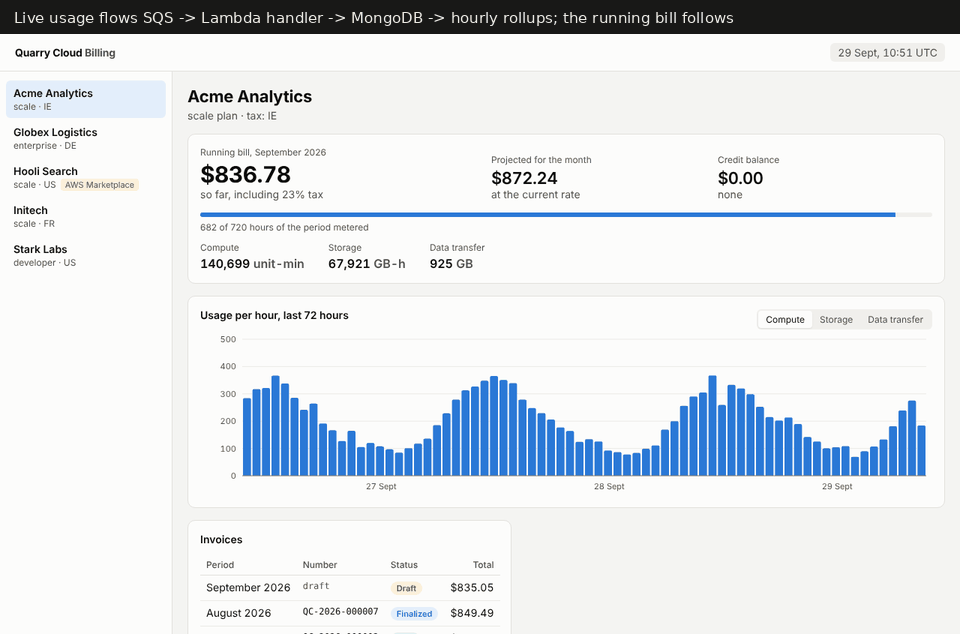

# usage-billing

Usage-based billing for a fictional managed database service, "Quarry Cloud". Customers' databases report compute, storage and data transfer as they use them, and at the end of the month every customer gets an invoice that has to be right to the cent: late data, retried messages, plan changes, prepaid commitments, trial credits and sales tax included. Customers who bought through AWS Marketplace get their usage reported to AWS every hour instead. The interesting part is not the arithmetic. It is keeping the numbers correct while the input arrives late, twice or broken.



## How it works

```
services ──SQS──> ingest handler ──> usage_records ──> dirty hours ──> aggregator ──> hourly/daily rollups
                  (Lambda shape)      (MongoDB)                                          │
                                                                    ┌────────────────────┼─────────────────────┐
                                                                    v                    v                     v
                                                         rating + invoicing     running estimate    marketplace reporter
                                                         (draft -> finalized)   (API / UI)          (BatchMeterUsage)
```

### Metering: at-least-once in, exactly-once stored

- Services send envelopes of usage records to SQS. Quantities are **decimal strings** (`"12.5"`), never JSON numbers, so no producer has to put a billable value through a float.
- `src/metering/handler.ts` is a plain Lambda handler (`SQSEvent` in, `SQSBatchResponse` out). Locally it is driven by `src/metering/poller.ts`, which does what the Lambda event source mapping does: batching window, concurrency, deleting what succeeded.
- **Idempotency.** The record id is a hash of org, service, meter and the producer's event id (`src/metering/record.ts`), and `_id` is unique. A redelivery or a producer resend becomes a duplicate-key no-op. If the same id comes back with a different quantity, that is a producer bug: it is parked as a conflict instead of silently overwriting what may already have been billed.
- **Partial batch failures.** Malformed input can never succeed, so it is acknowledged and parked in `rejected_records` with the reason. Storage errors fail only the messages they affect. A message that keeps failing ends up in the dead-letter queue (tested against ElasticMQ).
- The handler writes the record first and flags its org-hour as dirty second, and it flags duplicates too. If it dies between the two steps, the redelivery repairs the flag.

### Rollups and late data

- The aggregator (`src/rollups/aggregator.ts`) **rebuilds** each flagged org-hour from the raw records. It does not increment anything. Running it twice, crashing half-way, or receiving data for an hour that closed days ago all converge on the same numbers.
- A flag is cleared with compare-and-delete on a token that changes on every flag. If new records land while their hour is being rebuilt, the flag survives and the hour is rebuilt again.
- Records that arrive after their hour closed (hour end plus a two-hour grace) are counted per rollup as `lateRecords`, so the drill-down can show them.
- `src/rollups/reconcile.ts` recomputes usage from raw records along an independent path and compares it with both rollup levels. It can re-flag the hours that disagree. `src/rollups/backfill.ts` flags everything in a range after a bulk import.

### Money

- **No floats.** Quantities are bigint micro-units, unit prices are bigint nano-dollars, and their product is exact (1e-15 USD). Amounts are integer cents. MongoDB stores them as Int64, and the driver reads them back as bigint (`useBigInt64`). The API sends them as strings, and the UI formats them with BigInt.
- **Rounding rules** (`src/money/fixed.ts`, `src/rating/rate.ts`):
  1. Each invoice line is rounded once to the cent, half to even, after exact tier arithmetic.
  2. Base fees are prorated on cumulative positions: the fee for `[a, b)` is `round(fee x b/P) - round(fee x a/P)`. Any split of a month under one plan therefore adds up to exactly the monthly fee. This is a property test.
  3. The contract discount is a percentage of the usage lines, rounded half to even.
  4. Tax is computed on the invoice's taxable total and rounded half up, the commercial rounding tax authorities expect.
- **Pricing** (`src/rating/price.ts`): graduated tiers or volume pricing per meter. A mid-cycle plan change splits the period into segments. Each segment pays its plan's base fee for its share of time, and its **tier allowances shrink by the same fraction**, so a customer who upgrades on the 20th doesn't get two full free tiers. fast-check covers additivity, monotonicity and the identity for full periods.
- **Credits** (`src/rating/credits.ts`): trial credits and prepaid commitments are grants with balances. They burn soonest-expiring first, free before paid. What is left of a grant when its last eligible period is finalized is written off and audited.

### Invoicing

- **Idempotent per org and period.** There is one live invoice per org and period, enforced by a unique index on `activeKey`, which is unset when an invoice is voided. Drafts are regenerated from the rollups until finalization. Concurrent runs converge on one document, and an unchanged draft is not rewritten.
- **State machine** `draft -> finalized -> paid | void` (`src/invoicing/invoice-service.ts`). Finalizing is only allowed after the period and its grace window have closed. It recomputes from current data, then **in one MongoDB transaction**:
  - burns credits, guarded on their balances;
  - assigns a gapless number from a counter;
  - freezes the content under a SHA-256 hash;
  - records a settlement of what was billed;
  - writes the audit entries.
- **Finalized invoices never change.** Every update is filtered on the expected status, and `verify()` recomputes the hash. The UI shows the result.
- **Usage that arrives after finalization** is not lost and not double billed. The next invoice re-rates the earlier period with the late usage and bills the difference against the settlement as an adjustment line (the tiered price of the late units, not their average price). The settlement moves forward in the same transaction.
- **Void** works only on an org's latest finalized invoice. Later invoices have built on the earlier ones, so those are corrected with adjustments instead. Voiding gives back the credits the invoice used.
- **Tax** sits behind a `TaxProvider` port (`src/tax/`). The included provider covers a seller established in Ireland:
  - domestic VAT;
  - EU reverse charge for business customers with a VAT id, with the Art. 196 statement on the invoice;
  - destination-country VAT for EU consumers (OSS);
  - a small US state sales tax table;
  - out of scope everywhere else.
- **Audit log** (`src/audit/audit-log.ts`): append-only and hash-chained. Every money-affecting change is audited: org creation, plan change, contract, credit grant, burn, expiry, restore, finalize, pay, void, adjustment and marketplace report. Entries are written in the same transaction as the change, so the log cannot disagree with the data. `verify()` detects edited, removed or truncated entries.

### AWS Marketplace

- `src/marketplace/fake-aws-metering.ts` speaks the real wire protocol (`awsJson1_1`, `X-Amz-Target: AWSMPMeteringService.BatchMeterUsage`), so the **official AWS SDK client** is used against it unchanged. Like AWS, it keeps one record per customer, dimension and hour, and answers a repeat with `DuplicateRecord`. It can inject throttling, 5xx errors, unprocessed records and lost responses, where the request was processed but the answer never came back.
- AWS only accepts whole units. Each hourly run reports `floor(total usage so far) - everything already reported or in flight` (`src/marketplace/reporter.ts`). Fractions carry over, late usage for any earlier hour goes out with the next report, and repeated or crashed runs report nothing twice.
- AWS rejects records older than six hours. A report that was only ever throttled and then ran out of time is re-planned under a later hour. A report where any attempt *might* have reached AWS (a 5xx or a lost connection) is never re-planned. It is marked `unresolved` for manual reconciliation. Under-billing is recoverable. Billing a customer twice through their AWS account is not.
- Orgs billed through the marketplace get no card invoice. The invoice run skips them.

### API and UI

Fastify (`src/api/server.ts`) and React 19 + Vite (`web/`). The UI shows:

- the hourly usage chart per meter, updating live;
- the current period's running bill with a linear projection to month end;
- the invoice list with line items;
- a drill-down from any usage line to its price bands and the hourly rollups behind it, which says whether those rollups changed after invoicing;
- for an adjustment line, the before and after usage and net of the period it corrects.

## Correctness check: the month simulation

`src/sim/` generates a month of usage plus the first three days of the next for N orgs. The generated traffic includes:

- producer resends, malformed messages, and late usage both before and after finalization;
- upgrades mid-month and mid-month signups;
- trial credits, prepaid contracts with discounts, and six tax situations;
- marketplace orgs.

All of it goes through ElasticMQ, the handler, MongoDB, rollups, both invoice runs, and the fake AWS endpoint with faults switched on. A separate implementation of the billing rules in decimal.js (`src/sim/oracle.ts`) computes every expected invoice directly from the generated events, with no SQS, MongoDB or rollups. The two must agree to the cent on subtotal, discount, credits, tax and total.

With 24 orgs (77,099 records), all 40 invoices match. 19 of them carry adjustment lines for late usage. Despite 463 injected failures, the reported marketplace units equal the metered units exactly. 600 of the retries were deduplicated by AWS, and none were left unresolved. The end-to-end test runs the same simulation with 12 orgs.

## Measured

On a shared 2-vCPU VM that was running other builds at the same time, with MongoDB from mongodb-memory-server (single-node replica set, WiredTiger) and ElasticMQ on the same machine (`npm run bench -- --records 200000 --orgs 1000`):

| | |
| --- | --- |
| Publish to SQS (100 records per message) | 200,000 records in 3.1 s, 64,000 records/s |
| SQS -> handler -> MongoDB, 1 poller | 10,500 records/s |
| SQS -> handler -> MongoDB, 2 or 4 pollers | 15,800 records/s (both cores busy) |
| Rebuild rollups from raw | 18,000 org-hours and 15,000 org-days in 19.3 s |
| Invoice drafts, 1,000 orgs x 2.16 M hourly rollups | 3.5 s (283 orgs/s) |
| Finalize 1,000 invoices (recompute + transaction + audit) | 13.1 s (77 orgs/s) |

Finalization is serialized on the audit chain head on purpose: gapless audit sequence numbers cost throughput, and 1,000 invoices in 13 seconds leaves plenty of room for a monthly job. If it ever didn't, the chain could be sharded per org.

## Tech stack

Node.js 22 with native TypeScript (strict, `noUncheckedIndexedAccess`, no `any`), MongoDB driver 7 (transactions, Int64 as bigint), AWS SDK v3 (SQS, Marketplace Metering), `@types/aws-lambda`, Fastify, zod, React 19, Vite, vitest, fast-check, decimal.js for the reference calculation, mongodb-memory-server, ElasticMQ, Playwright for the preview, Terraform.

ElasticMQ was chosen over moto for SQS because it is a standalone server with real visibility timeouts and redrive policies. The dead-letter behaviour is tested against it, not mocked. The jar is downloaded to `.local/` on first use (Java is required).

## Running it

```bash
npm ci
npm run dev            # seeds July to late September, then runs live in accelerated time; API on :4310
npm run dev:web        # UI on http://localhost:5310
```

`npm run dev` starts its own MongoDB replica set (mongodb-memory-server downloads a `mongod` binary on first run) and ElasticMQ, unless `MONGO_URL` / `SQS_ENDPOINT` point at running ones. `DEMO_SPEED` sets simulated seconds per real second (default 1800).

```bash
npm run simulate -- --orgs 50     # the month simulation, printed as in the preview
npm run bench                     # the numbers above
npm run sqs                       # just ElasticMQ on :9335
```

The Lambda entry points are in `src/lambda/handlers.ts`. `infra/terraform` is a skeleton that `terraform validate` accepts: the usage queue with a DLQ and an alarm, the ingestion function with `ReportBatchItemFailures` and capped concurrency, and EventBridge schedules for rollups, marketplace reporting and the monthly run. Bundling the handlers into the zip it expects is not part of this repository.

## Tests

```bash
npm run typecheck
npm test               # 117 tests: unit, integration against MongoDB + ElasticMQ, the end-to-end month
```

- **79 unit tests**: fixed-point math, rating, proration, credits, tax and the handler with a faulty in-memory store, many of them property-based.
- **30 integration tests** against a real replica set and ElasticMQ, started once per run by `test/global-setup.ts`. They cover ingestion with a flaky database, the DLQ, rollups, reconciliation, the invoice lifecycle with concurrent drafts and finalization, the marketplace reporter under faults, and the API.
- **5 end-to-end checks** on the month simulation.
- **3 UI formatting tests.**

## Layout

```
src/metering/     record validation, SQS handler, local poller, publisher
src/rollups/      aggregator, reconciliation, backfill, usage queries
src/money/        bigint fixed-point and rounding
src/rating/       plans, tiered/volume pricing, proration, credits
src/invoicing/    invoice model, pure builder, service (state machine), monthly run
src/tax/          TaxProvider port and the static EU VAT / US sales tax provider
src/audit/        hash-chained audit log
src/marketplace/  fake AWS Marketplace Metering endpoint, SDK client, hourly reporter
src/api/          Fastify routes
src/sim/          workload generator, decimal.js oracle, month simulation
src/lambda/       Lambda entry points
web/              React UI
bench/            benchmark
infra/terraform/  SQS, DLQ, Lambda and schedules
```

## Known limitations

- One currency (USD). Prices and rates are illustrative, not anyone's real price list or a complete tax engine. VAT ids are format-checked, not verified against VIES.
- A credit grant can be used by any period it was valid in at some point. A trial that expires on the 10th still covers that month's invoice.
- Paid invoices cannot be voided. Refunds and credit notes are out of scope.
- The audit log is append-only by construction and verifiable. In production it would also get database permissions that forbid updates and deletes.
- Marketplace reports left `unresolved` need someone to compare them with AWS's own reports. There is no AWS API to ask.

## License

MIT
